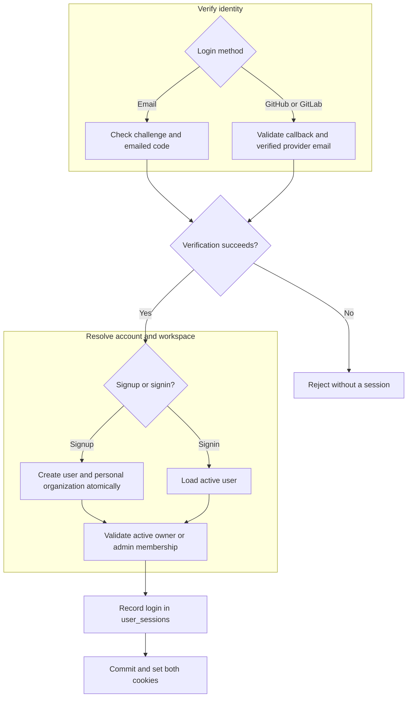
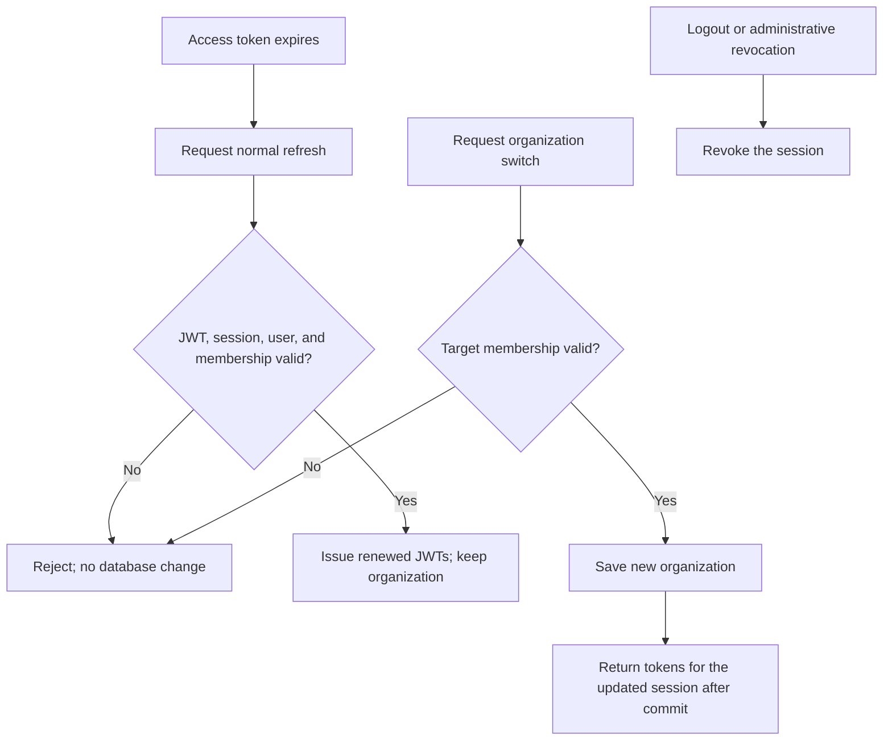

# Login: ADR

Implementation: Partial. Core sessions, read-only renewal, organization switching, cookie/JSON delivery, and protected API middleware are implemented. Signout is implemented; OAuth remains planned.

## Problem and requirements

The current signup API gives credentials to frontend code. We need a browser login that keeps reusable credentials out of JavaScript, supports session revocation, and preserves access to the correct organization.

Users authenticate without passwords through [email codes](email.md), [GitHub](github.md), or [GitLab](gitlab.md). Email accepts any valid domain; OAuth requires a verified provider email. Returning with an already-linked provider account must identify the same user.

Signup creates a user and personal organization atomically. Signin loads an existing active user. Neither action grants membership in another organization. Sessions must remain renewable until 30 days pass without a successful refresh.

## Decision and rationale

Default to short-lived access JWTs and renewable refresh JWTs in secure HttpOnly cookies. Each signup/signin step accepts `delivery: "cookie" | "token"`: cookie mode omits token values from JSON; token mode returns them and sets no cookies. Delivery is an HTTP concern, never a Core property or JWT claim. Vite and Axum share one origin, so the browser sends cookies without exposing their values to frontend code.

Explicit token-issuing responses return validity metadata for cookie and token delivery. Lifetimes include `throttleSeconds`: 30 for OTP and 0 for access/refresh tokens. The portal uses this throttle for its resend countdown; SMTP throttling remains independent. See [token lifetime responses](session.md#token-lifetime-responses).

Each session belongs to an organization and user. Both JWT types embed Session directly: its ID, organization ID and name, user ID, and revocation state. Access JWTs also carry the membership role. Lookups and validation use Session directly. Every session operation checks organization and user together. Store the session, not the complete JWT; no separate refresh credential identifier is needed. Device information is optional.

| Alternative | Why we chose this approach |
| --- | --- |
| Credentials stored in frontend JavaScript | HttpOnly cookies prevent scripts from reading credential values; CSRF protection is then required. |
| Stateless refresh JWTs alone | Database state supports revocation and invalidating credentials when switching organizations. |

Cookies do not prevent injected scripts from making requests. The design still requires HTTPS, secure cookie attributes, Origin checks against CSRF, safe rendering, and a Content Security Policy.

## Login flow

This chart describes the target design. A verification challenge cannot authorize normal API requests.

Signin checks canonical email before sending a code and rejects unknown accounts with a signup link; confirmation rechecks the active user. Signup checks canonical email before sending a code: existing accounts receive 409 with a signin suggestion, with no email or new token. Confirmation still enforces uniqueness to handle concurrent signup. Signin starts in an active owner/admin organization; later switching may select an organization where the user is a member.

## Renewal and logout

Refresh preserves the session without database writes and issues another 30-day refresh JWT. Earlier credentials remain usable until expiry; revoked sessions cannot renew.

Switching validates target membership, saves the organization, and issues both tokens after commit. Other-organization refresh tokens fail validation; returning to an earlier organization accepts its unexpired tokens again. Logout revokes the session and clears cookies.

A copied access JWT remains usable until expiry, including its cached role. Immediate invalidation requires an additional server-side check. This is the cost of validating normal requests without consulting refresh-session state.

## Responsibilities and compatibility

Axum owns cookies and browser request protections; Core owns authentication and membership rules; PostgreSQL owns session persistence and conditional updates. Protected API middleware selects explicit Bearer credentials before cookies, verifies token claims, and inserts verified token structs as separate typed request extensions. Invalid Bearer credentials never fall back to cookies. Cookie renewal occurs only when access is missing or expired; handlers enforce resource scope and roles.

The session owns validation, renewal, organization switching, and revocation behavior. Its organization name is a display snapshot, excluded from identity and concurrency comparisons. Current-user responses read verified access claims without querying organizations. Login, renewal, and switching load the organization name through membership queries; renames become visible in newly issued tokens. Persistence provides create, find, and conditional update; saving stale state cannot undo revocation or overwrite a concurrent organization change.

Signup creates the user, personal organization, and first session atomically. JWT validity controls the inactivity window; the database stores identity, scope, and revocation.

Clients expecting JSON credentials must explicitly request token delivery. Tokens missing the required session organization name require signin again.

## Unresolved before implementation

The [authentication pages](interface.md) accept consumer controllers with scoped Zustand stores and granular UI subscriptions. Store factories and controller interfaces belong to the UI library. The portal uses the generated cookie-delivery API client, rendering signup at `/` (also `/signup`) and signin at `/login`, with reloadable `/signup/confirmation` and `/login/confirmation` steps. After confirmation the portal verifies `/api/auth/me`, retains the current identity in root in-memory auth state, and navigates to `/:organizationName/chat`.

- Which operations require immediate access-token revocation; the current access lifetime is 30 minutes.
- Cross-provider account linking and which login methods ship first.
- The [email-code expiry and reuse discrepancy](email.md).

[Browser sessions](session.md) defines the session record, lifecycle, and cookie protections. [Organization](../organization/adr.md) owns workspace membership policy.
