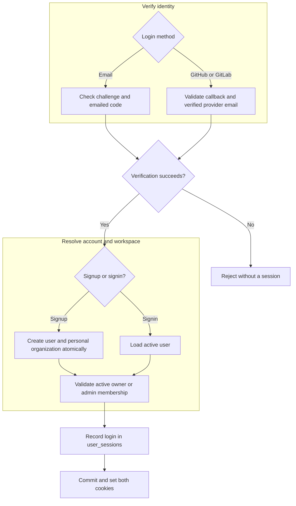
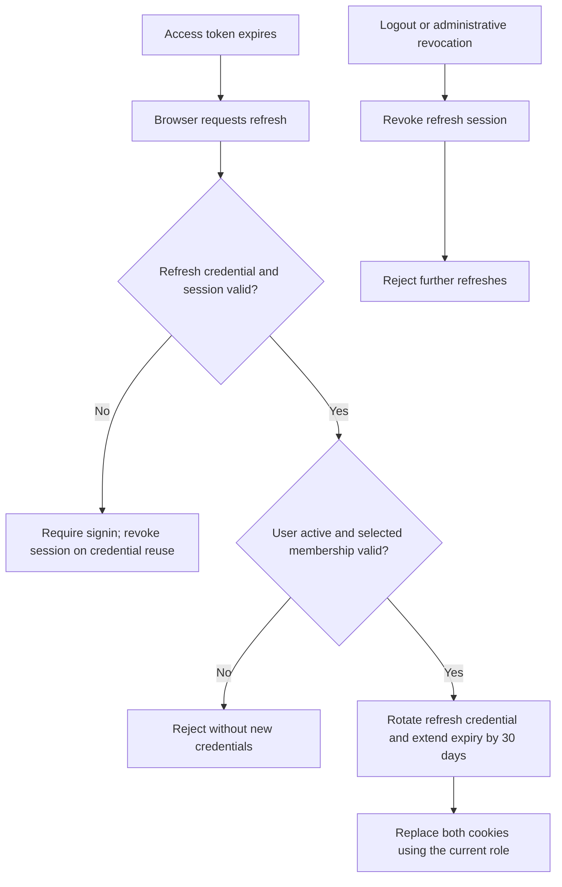

# Login: ADR

Decision: Accepted on 2026-10-26. Implementation: Partial. Email signup currently returns tokens in JSON; OAuth, cookie delivery, and persistent refresh sessions are planned.

## Problem and requirements

The current signup API gives credentials to frontend code. We need a browser login that keeps reusable credentials out of JavaScript, supports session revocation, and preserves access to the correct organization.

Users authenticate without passwords through [email codes](email.md), [GitHub](github.md), or [GitLab](gitlab.md). Email accepts any valid domain; OAuth requires a verified provider email. Returning with an already-linked provider account must identify the same user.

Signup creates a user and personal organization atomically. Signin loads an existing active user. Neither action grants membership in another organization. Sessions must remain renewable until 30 days pass without a successful refresh.

## Decision and rationale

Use short-lived access JWTs and rotating refresh credentials in secure HttpOnly cookies. Vite and Axum share one origin, so the browser sends cookies without exposing their values to frontend code.

Access JWTs contain the user ID, organization ID, and membership role. Refresh JWTs contain the user ID, a stable session ID, and a rotating credential identifier, without organization claims. Each successful login creates a `user_sessions` row; store the current credential identifier, not the complete refresh token. Device information is optional.

| Alternative | Why we chose this approach |
| --- | --- |
| Credentials stored in frontend JavaScript | HttpOnly cookies prevent scripts from reading credential values; CSRF protection is then required. |
| Stateless refresh JWTs alone | Database state lets the server invalidate replaced credentials and revoke refresh sessions. |

Cookies do not prevent injected scripts from making requests. The design still requires HTTPS, secure cookie attributes, Origin checks against CSRF, safe rendering, and a Content Security Policy.

## Login flow

This chart describes the target design. A verification challenge cannot authorize normal API requests.

Signup rejects an existing email. Signin starts in an active owner/admin organization; later switching may select an organization where the user is a member.

## Renewal and logout

Refresh updates the same session; it does not record another login. Routine refresh supplies the current organization. If omitted, select the oldest active membership, breaking ties by organization ID. Logout revokes that session and clears both cookies.

A copied access JWT remains usable until expiry, including its cached role. Immediate invalidation requires an additional server-side check. This is the cost of validating normal requests without consulting refresh-session state.

## Implementation impact

Axum owns cookies and browser request protections; Core owns authentication and membership rules; PostgreSQL owns refresh-session persistence and atomic rotation. The frontend coordinates renewal without reading credentials.

Replace `UserRepository::record_login` with session creation through a dedicated `SessionRepository`. Signup records its first session in the same transaction as user and personal-organization creation. Failed authentication or a failed transaction creates no login record and returns no credentials. The session's creation time records the login; refresh only updates activity and expiry.

Changing signup from JSON credentials to cookies changes the frontend contract. Deliver the API and generated client updates together, and document the new transport in the public reference. Add refresh persistence before relying on rotation or revocation; issuing a new JWT alone does not invalidate the old one.

## Unresolved before implementation

- Exact access lifetime within 5–15 minutes, plus any operations requiring immediate revocation.
- Concurrent refreshes across tabs and recovery when a rotation response is lost.
- Cross-provider account linking and which login methods ship first.
- The [email-code expiry and reuse discrepancy](email.md).

[Browser sessions](session.md) defines the session record, lifecycle, and cookie protections. [Organization](../organization/adr.md) owns workspace membership policy.
