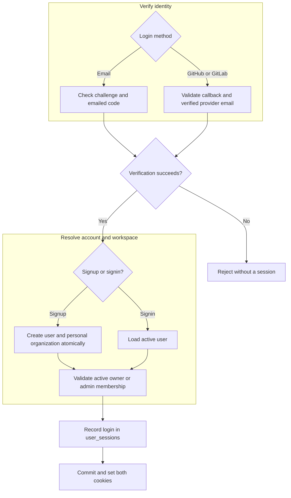
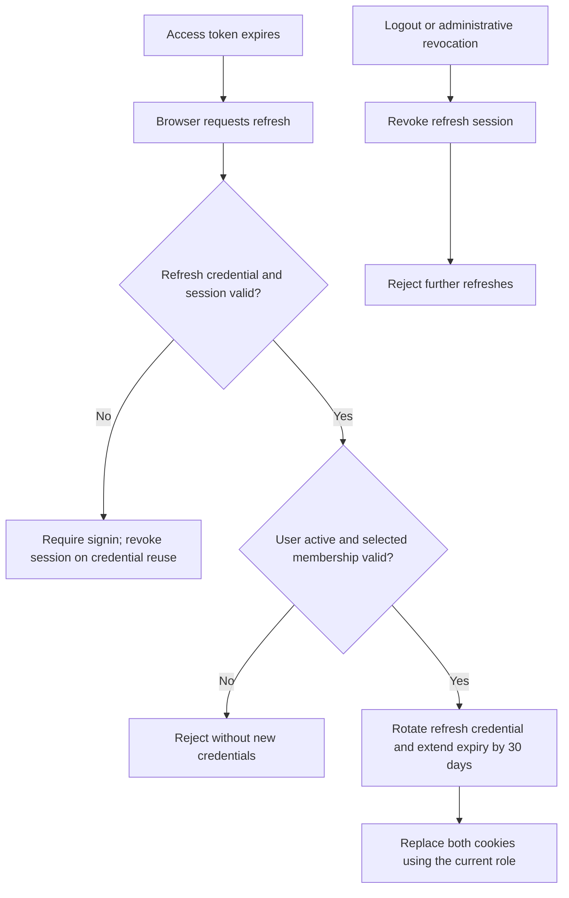

# Login: ADR

Decision: Accepted on 2026-10-26. Implementation: Partial. Core authentication now records sessions and rotates refresh credentials. The signup API still returns tokens in JSON; OAuth and cookie delivery remain planned.

## Problem and requirements

The current signup API gives credentials to frontend code. We need a browser login that keeps reusable credentials out of JavaScript, supports session revocation, and preserves access to the correct organization.

Users authenticate without passwords through [email codes](email.md), [GitHub](github.md), or [GitLab](gitlab.md). Email accepts any valid domain; OAuth requires a verified provider email. Returning with an already-linked provider account must identify the same user.

Signup creates a user and personal organization atomically. Signin loads an existing active user. Neither action grants membership in another organization. Sessions must remain renewable until 30 days pass without a successful refresh.

## Decision and rationale

Use short-lived access JWTs and rotating refresh credentials in secure HttpOnly cookies. Vite and Axum share one origin, so the browser sends cookies without exposing their values to frontend code.

Each session belongs to an organization and user. Both JWT types carry that session reference; access JWTs also carry the membership role, and refresh JWTs carry the current credential identifier. Every session operation checks organization and user together. Store the current credential identifier, not the complete JWT. Device information is optional.

| Alternative | Why we chose this approach |
| --- | --- |
| Credentials stored in frontend JavaScript | HttpOnly cookies prevent scripts from reading credential values; CSRF protection is then required. |
| Stateless refresh JWTs alone | Database state lets the server invalidate replaced credentials and revoke refresh sessions. |

Cookies do not prevent injected scripts from making requests. The design still requires HTTPS, secure cookie attributes, Origin checks against CSRF, safe rendering, and a Content Security Policy.

## Login flow

This chart describes the target design. A verification challenge cannot authorize normal API requests.

Signup rejects an existing email. Signin starts in an active owner/admin organization; later switching may select an organization where the user is a member.

## Renewal and logout

Refresh updates the same session; it does not record another login. With no organization selection, keep the current session organization. An explicit switch validates the target membership, moves the session, and issues both tokens for the new organization. Logout revokes that session and clears both cookies.

A copied access JWT remains usable until expiry, including its cached role. Immediate invalidation requires an additional server-side check. This is the cost of validating normal requests without consulting refresh-session state.

## Responsibilities and compatibility

Axum owns cookies and browser request protections; Core owns authentication and membership rules; PostgreSQL owns refresh-session persistence and atomic rotation. The frontend coordinates renewal without reading credentials.

The session owns refresh and revocation behavior. Persistence provides create, find, and conditional update; saving stale state cannot undo revocation or overwrite a concurrent credential change.

Session creation records each successful login. Signup creates its first session together with the user and personal organization; failure leaves no partial account or login record. Refresh updates activity and expiry while preserving the original login time.

Changing signup from JSON credentials to cookies will require coordinated API and frontend updates. Existing refresh tokens without a session ID require signin after the session-based flow is deployed.

Reusing an old refresh credential in the current organization revokes the session, including after competing refreshes or a lost response. Tokens for a previous organization no longer resolve the session after switching and are rejected. Clients must coordinate renewal; there is no replay grace period.

## Unresolved before implementation

- Exact access lifetime within 5–15 minutes, plus any operations requiring immediate revocation.
- Cross-provider account linking and which login methods ship first.
- The [email-code expiry and reuse discrepancy](email.md).

[Browser sessions](session.md) defines the session record, lifecycle, and cookie protections. [Organization](../organization/adr.md) owns workspace membership policy.
