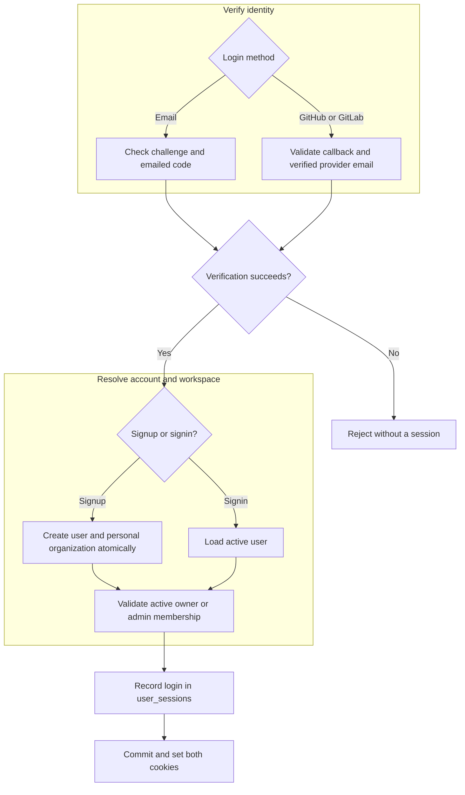
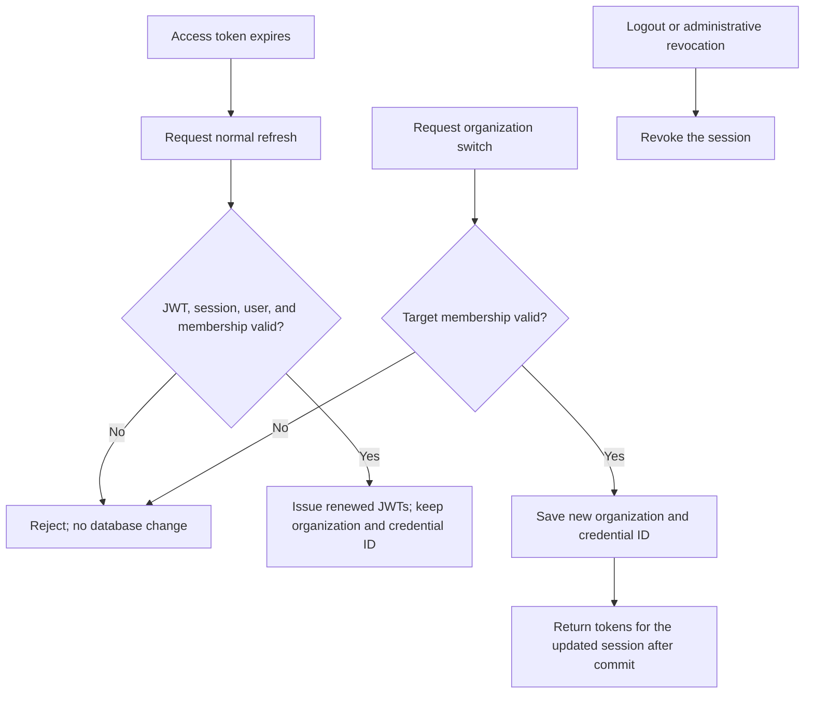

# Login: ADR

Decision: Accepted on 2026-10-26. Implementation: Partial. Core authentication records sessions; normal renewal is read-only and organization switching is separate. Signup/signin code requests and confirmation support controller-selected cookie or JSON token delivery. Confirmation requires an OTP access token from the access cookie or Bearer header. Protected API middleware accepts access cookies or Bearer access tokens and automatically renews expired/missing cookie access. Logout endpoints and OAuth remain planned.

## Problem and requirements

The current signup API gives credentials to frontend code. We need a browser login that keeps reusable credentials out of JavaScript, supports session revocation, and preserves access to the correct organization.

Users authenticate without passwords through [email codes](email.md), [GitHub](github.md), or [GitLab](gitlab.md). Email accepts any valid domain; OAuth requires a verified provider email. Returning with an already-linked provider account must identify the same user.

Signup creates a user and personal organization atomically. Signin loads an existing active user. Neither action grants membership in another organization. Sessions must remain renewable until 30 days pass without a successful refresh.

## Decision and rationale

Default to short-lived access JWTs and renewable refresh JWTs in secure HttpOnly cookies. Each signup/signin step accepts `delivery: "cookie" | "token"`: cookie mode omits token values from JSON; token mode returns them and sets no cookies. Delivery is an HTTP concern, never a Core property or JWT claim. Vite and Axum share one origin, so the browser sends cookies without exposing their values to frontend code.

Each session belongs to an organization and user. Both JWT types embed Session: its ID, organization ID, user ID, current credential identifier, login time, and revocation state. Access JWTs also carry the membership role. Neither token repeats fields already owned by Session. Every session operation checks organization and user together. Store the current credential identifier, not the complete JWT. Device information is optional.

| Alternative | Why we chose this approach |
| --- | --- |
| Credentials stored in frontend JavaScript | HttpOnly cookies prevent scripts from reading credential values; CSRF protection is then required. |
| Stateless refresh JWTs alone | Database state supports revocation and invalidating credentials when switching organizations. |

Cookies do not prevent injected scripts from making requests. The design still requires HTTPS, secure cookie attributes, Origin checks against CSRF, safe rendering, and a Content Security Policy.

## Login flow

This chart describes the target design. A verification challenge cannot authorize normal API requests.

Signup rejects an existing email. Signin starts in an active owner/admin organization; later switching may select an organization where the user is a member.

## Renewal and logout

Normal refresh keeps the organization and credential identifier and performs no database write. It issues JWTs valid for another 30 days. Older refresh JWTs remain usable until their own expiry; renewal does not consume them. Expired or revoked credentials are rejected without another revocation write.

Organization switching is a separate operation: validate the target membership, change the stored organization and credential identifier, and return both new tokens after commit. Old credentials then fail validation. Logout explicitly revokes the session and clears its cookies.

A copied access JWT remains usable until expiry, including its cached role. Immediate invalidation requires an additional server-side check. This is the cost of validating normal requests without consulting refresh-session state.

## Responsibilities and compatibility

Axum owns cookies and browser request protections; Core owns authentication and membership rules; PostgreSQL owns session persistence and conditional updates. Protected API middleware selects explicit Bearer credentials before cookies, verifies token claims, and inserts verified token structs as separate typed request extensions. Invalid Bearer credentials never fall back to cookies. Cookie renewal occurs only when access is missing or expired; handlers enforce resource scope and roles.

The session owns validation, renewal, organization switching, and revocation behavior. Persistence provides create, find, and conditional update; saving stale state cannot undo revocation or overwrite a concurrent credential change.

Session creation records each successful login. Signup creates its first session together with the user and personal organization; failure leaves no partial account or login record. JWT validity enforces the sliding inactivity window; the database records login creation, scope, current credential, and revocation without pretending to track each renewal.

Clients expecting JSON credentials must explicitly request token delivery. Existing tokens without an embedded session require signin after the session-based flow is deployed.

A stolen refresh JWT remains renewable until it expires or the session is explicitly revoked or changed. This is the accepted tradeoff for read-only renewal. No automatic reuse revocation or refresh-specific transaction restriction remains.

## Unresolved before implementation

- Which operations require immediate access-token revocation; the current access lifetime is 15 minutes.
- Cross-provider account linking and which login methods ship first.
- The [email-code expiry and reuse discrepancy](email.md).

[Browser sessions](session.md) defines the session record, lifecycle, and cookie protections. [Organization](../organization/adr.md) owns workspace membership policy.
